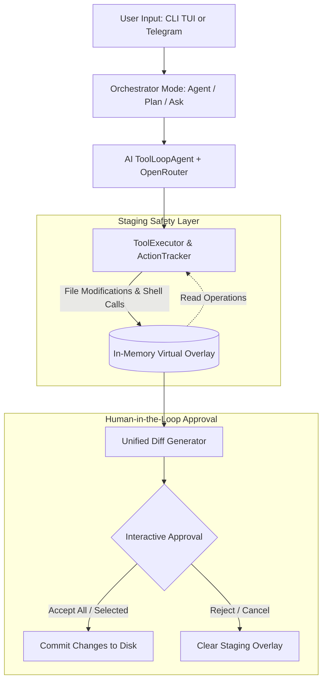

# 🦅 OpenClaw (`ashcodeclaw`)

> **An Autonomous AI Coding Agent & Dual-Interface Assistant (CLI & Telegram)** powered by Bun, Vercel AI SDK, OpenRouter, and Firecrawl.

---

## 📌 Overview

**OpenClaw** (CLI alias: `ashcodeclaw-build`) is a local, developer-first autonomous AI coding agent designed to understand, plan, modify, and execute tasks across your codebase.

Unlike conventional coding bots that blindly modify files on disk, **OpenClaw implements a strict Safety-First Staging Engine**: all modifications (file creations, file edits, folder creations, and shell commands) are staged in memory with unified diff previews. Changes are applied to disk **only after your explicit user approval**, either in an interactive terminal TUI or directly through Telegram!

---

## 🚀 Key Highlights & Capabilities

- ⚡ **Ultra-Fast Runtime**: Built natively on [Bun](https://bun.com) for high performance and fast execution.
- 🛡️ **In-Memory Staging & Diff Approval**: Zero unreviewed mutations. See before/after diffs and selectively accept or reject every single file change.
- 💬 **Dual Interface**:
  - **Terminal TUI**: Beautiful ASCII shadow banner, interactive menus, spinners, and Markdown rendering via `@clack/prompts` and `marked-terminal`.
  - **Telegram Bot**: Full remote control over your workspace with inline keyboard buttons, live diffs, and owner authorization...
- 🧠 **Multi-Model Intelligence**: Powered by `@openrouter/ai-sdk-provider` and Vercel AI SDK (`ai`), allowing instant switching between free models (`openrouter/free`, `openai/gpt-oss-20b`) and top-tier frontier models.
- 🌐 **Live Web Intelligence**: Firecrawl integration (`@mendable/firecrawl-js`) for real-time web search and markdown scraping (auto-falls back if no key provided).
- 🧩 **Extensible Skills Architecture**: Dynamic support for custom workspace skills defined in `skills/` or `.agents/skills/` using `SKILL.md`.

---

## ⚙️ How It Works (Architecture & Workflow)

OpenClaw operates on a 4-layer execution pipeline:



### 1. Planning & Reasoning
The agent examines your workspace within boundary checks (`Path escapes workspace` protection), searches files, reads contents, or crawls external docs via Firecrawl.

### 2. In-Memory Virtual Staging
When the agent issues `create_file`, `modify_file`, `delete_file`, `create_folder`, or `execute_shell`, actions are intercepted by `ToolExecutor` and recorded in `ActionTracker`. Disk files remain 100% untouched while subsequent read operations see the in-memory buffered changes.

### 3. Review & Approval (Human-in-the-Loop)
- **CLI**: Review each file diff interactively (`Accept`, `Reject`, `Show Diff`, or `Apply All`).
- **Telegram**: Receive an inline summary with buttons: `📋 Show Diff`, `✅ Accept All`, and `❌ Reject All`.

### 4. Atomic Execution
Only approved operations are flushed to disk. Rejected modifications are instantly discarded.

---

## 🗂️ Modes Breakdown

### 1. 🤖 Agent Mode (`/agent` or CLI Agent)
Autonomous task execution mode:
- Give a natural language instruction (e.g., *"Create an Express authentication middleware with JWT validation"*).
- Runs up to **40 autonomous reasoning steps**.
- Uses filesystem tools (`read_file`, `create_file`, `modify_file`, `search_files`, `analyze_codebase`, etc.).
- Prompts for staging diff approval before applying modifications.

### 2. 📋 Plan Mode (`/plan` or CLI Plan)
Two-phase structured execution for complex features:
- **Phase 1: Plan Generation**:
  - Researches codebase and optional web resources.
  - Generates a structured JSON plan (1–15 steps) with `title`, `description`, `hints`, and `complexity` (low/medium/high).
- **Phase 2: Selective Execution**:
  - **CLI**: Checklist where you select exactly which steps to execute.
  - **Telegram**: Interactive inline keyboard where you toggle steps (`✅ / ⬜`), select all, deselect all, and tap `🚀 Proceed`.
  - Executes each step in sequence with real-time feedback and stages all file changes for final approval.

### 3. ❓ Ask Mode (`/ask` or CLI Ask)
Read-only consultation mode:
- Ask questions about your architecture, dependencies, or bug causes.
- Strictly read-only tools (cannot modify code or execute destructive commands).
- Renders answers in rich terminal markdown.
- **Save to File**: Option to save Q&A logs to a `.md` file in the workspace.

### 4. 📱 Telegram Bot Mode
Control your workspace from anywhere using Telegram:
- **Secure by Design**: Enforces owner authentication (`TELEGRAM_OWNER_ID`). Any unauthorized user attempting interaction is ignored.
- **Commands**:
  - `/start` — Displays the welcome message and command overview.
  - `/ask <question>` — Ask questions about the codebase from your phone.
  - `/agent <goal>` — Run autonomous code generation remotely with inline diff approval.
  - `/plan <goal>` — Generate a step-by-step plan with interactive inline toggle buttons.

---

## 📁 Project Structure

```text
openclaw/
├── ai/
│   ├── ai.config.ts          # OpenRouter client provider & model loader
│   └── index.ts              # Export interface for AI models
├── modes/
│   ├── agent/                # Autonomous Agent Mode
│   │   ├── action.tracker.ts # Tracks staged & executed actions
│   │   ├── agent-tools.ts    # AI tools (read, write, delete, search, shell, skills)
│   │   ├── approval.ts       # Interactive CLI diff & approval workflow
│   │   ├── diff-view.ts      # Unified git-style diff builder
│   │   ├── orchestrator.ts   # Agent loop orchestrator
│   │   ├── tool-executor.ts  # Virtual overlay, filesystem, and shell executor
│   │   └── types.ts          # Action logs, configuration, and interfaces
│   ├── ask/
│   │   └── orchestrator.ts   # Read-only Q&A orchestrator
│   ├── plan/
│   │   ├── orchestrator.ts   # Plan mode orchestrator & step runner
│   │   ├── planner.ts        # AI reasoning & structured JSON plan generator
│   │   ├── selection.ts      # Terminal multi-select prompts for plan steps
│   │   ├── types.ts          # Plan & PlanStep schemas
│   │   └── web-tools.ts      # Firecrawl search & web scraping tools
│   ├── telegram/             # Remote Telegram Interface
│   │   ├── agent-run.ts      # Telegram runner for Ask, Agent, and Plan
│   │   ├── approval-session.ts # Inline keyboard approval & diff handler
│   │   ├── auth.ts           # Owner verification middleware
│   │   ├── constants.ts      # Bot messages & constants
│   │   ├── handlers.ts       # Telegraf command and action callback handlers
│   │   ├── index.ts          # Telegram bot initialization & graceful shutdown
│   │   ├── plan-session.ts   # Telegram interactive plan session state
│   │   └── text.ts           # Text formatting & markdown helpers
│   └── cli.ts                # Main CLI interactive menu loop
├── tui/
│   ├── terminal-md.ts        # Markdown rendering with chalk & marked-terminal
│   └── wakeup.ts             # ASCII Shadow banner & startup mode picker
├── index.ts                  # Application entry point (Commander CLI)
├── package.json              # Dependencies and scripts
└── tsconfig.json             # TypeScript compiler configuration
```

---

## 🛠️ Tech Stack & Dependencies

| Category | Technology | Purpose |
| :--- | :--- | :--- |
| **Runtime** | [Bun](https://bun.com) | High-speed JavaScript & TypeScript runtime |
| **Agentic Framework** | [Vercel AI SDK (`ai`)](https://sdk.vercel.ai/) | `ToolLoopAgent`, structured outputs, and streaming |
| **LLM Provider** | `@openrouter/ai-sdk-provider` | OpenRouter API integration for multi-model access |
| **Web Scraping / Search** | `@mendable/firecrawl-js` | Search the web and crawl documentation into markdown |
| **Telegram Integration** | [Telegraf](https://telegraf.js.org/) | Modern Telegram bot framework for Node/Bun |
| **Terminal UI** | `@clack/prompts`, `chalk`, `figlet` | Interactive terminal UI, spinners, colors, and banner |
| **Diffs & Markdown** | `diff`, `marked`, `marked-terminal` | Unified git-like diffs & terminal markdown rendering |
| **CLI Parser** | `commander` | CLI flags and subcommands (`wakeup`, etc.) |

---

## 🚀 Getting Started

### 1. Prerequisites
Ensure you have **Bun** installed (version 1.0+ recommended):
```bash
# Install Bun (Linux/macOS/WSL)
curl -fsSL https://bun.sh/install | bash

# Install Bun on Windows (PowerShell)
powershell -c "irm bun.sh/install.ps1 | iex"
```

### 2. Installation
Clone the repository and install dependencies:
```bash
git clone https://github.com/AshishSharma975/OpenClaw.git
cd openclaw
bun install
```

### 3. Environment Variables Setup
Create a `.env` file in the root directory:
```bash
cp .env.example .env
```
Populate the environment variables:

```env
# Required: OpenRouter API for AI models
OPENROUTER_API_KEY=your_openrouter_api_key_here
OPENROUTER_DEFAULT_MODEL="openrouter/free"   # e.g., openai/gpt-oss-20b, anthropic/claude-3.5-sonnet

# Optional: Firecrawl for live web search & crawling (if omitted, web tools are disabled)
FIRECRAWL_API_KEY=your_firecrawl_api_key_here

# Required for Telegram Bot Mode
TELEGRAM_BOT_TOKEN=your_telegram_bot_token_from_botfather
TELEGRAM_OWNER_ID=your_telegram_numeric_user_id
```

> **How to get Telegram values:**
> - **`TELEGRAM_BOT_TOKEN`**: Create a new bot with [@BotFather](https://t.me/BotFather) on Telegram.
> - **`TELEGRAM_OWNER_ID`**: Send a message to [@userinfobot](https://t.me/userinfobot) on Telegram to get your numeric user ID.

---

## 💻 Usage

### Option A: Run directly with Bun
To launch the interactive TUI:
```bash
bun run index.ts wakeup
```

### Option B: Link globally as a CLI tool
You can link the command to run `ashcodeclaw-build` from any directory:
```bash
bun link
```
Now run:
```bash
ashcodeclaw-build wakeup
```

---

## 📱 Telegram Bot Setup & Workflow

1. Start OpenClaw in **Telegram Bot Mode**:
   ```bash
   bun run index.ts wakeup
   # Select "Telegram Bot Mode"
   ```
2. Open Telegram and search for your bot.
3. Send `/start`. The bot verifies your `TELEGRAM_OWNER_ID` and presents the command menu.
4. Use commands:
   - `/ask How is the project structured?`
   - `/agent Add a health check endpoint to index.ts`
   - `/plan Build a complete user authentication module`
5. Interact with buttons:
   - For `/plan`: Click on steps to toggle selection, then tap **🚀 Proceed**.
   - For `/agent`: Review staged changes with **📋 Show Diff**, then tap **✅ Accept All** or **❌ Reject All**.

---

## 🔒 Safety & Boundary Protections

OpenClaw is built with defense-in-depth security principles:
1. **Workspace Containment**: Any attempt to resolve paths outside the project root (`..` path traversals) throws a hard error (`Path escapes workspace`).
2. **Exclude Filter**: Sensitive files (`.git`, `.env`, `.env.*`, `node_modules`, `*.log`, `build`, `dist`) are strictly excluded from AI file operations.
3. **No Direct Writes**: Mutations only touch RAM until approved by the human operator.
4. **Owner Lockdown**: Telegram endpoints reject all requests originating from any chat ID other than `TELEGRAM_OWNER_ID`.

---

## 🤝 Contributing & License

Contributions, issues, and feature requests are welcome!
Feel free to open an issue or pull request on [GitHub](https://github.com/AshishSharma975/OpenClaw).

Distributed under the **MIT License**.